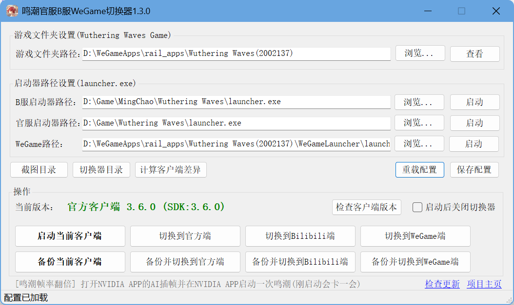

# WuWaSwitcher

WuWaSwitcher 是一个用于切换《鸣潮》游戏客户端版本的便捷工具，\
支持在 Bilibili 客户端、官方客户端、WeGame客户端之间快速切换，\
各客户端共用同一个游戏文件夹，以达到节省硬盘空间的目的。\
原理是对游戏的KrPcSdk\_Mainland文件夹及客户端差异文件进行备份和恢复。

## 近期公告

### **2026.9.11 鸣潮3.6.1版本B服更新**

当前版本 (2026.09.11 12:00:00):

`官方客户端3.6.0(SDK3.6.0)`\
`Bilibili客户端3.6.1(SDK3.6.1)`

新增差异清单项（添加到config.json"filesToBackup"下）:\
切换器1.3.0版本压缩包内默认配置文件已添加，就不要再加了\
"Client/Binaries/Win64/AntiCheatExpert/ACE-Base64.dll",\
"Client/Binaries/Win64/AntiCheatExpert/ACE-IDS64.dll",

### **2026.8.20 鸣潮3.6.0版本与3.5.3版本差异文件路径完全相同**

请按照切换器(1.2.3版本)压缩包内`参考config.json`修改`切换器所在目录\config.json`，添加所需备份文件路径。\
具体来说，复制填入`"filesToBackup"`字段即可，**记得在版本转换前备份当前客户端**，各客户端都备份后可以顺利切换。

## 功能特性

- 🚀 **快速版本切换** - 一键在 Bilibili 、WeGame、官方客户端之间切换，共用同一份游戏本体。
- 💾 **备份系统** - 备份当前版本，支持版本恢复
- 🔍 **版本检测** - 自动识别当前游戏客户端
- 🎮 **直接启动** - 快速启动当前配置的客户端

## 使用说明

### 1. 下载

1. 注意不是点`克隆/下载`，请点击仓库主界面右边侧边栏`发行版`下的`鸣潮官服B服WeGame切换器x.x.x`进行下载（[WuWaSwitcher 发行版](https://gitee.com/wn1027/wuwa-switcher/releases) ）。
2. 下载后找个空地方解压到此位置，配置文件和备份文件都将保存exe所在目录下。
3. 运行exe文件即可。
4. 更新说明及升级方式请看版本描述，一般覆盖exe文件就可以了。
5. **关于问题及反馈，B站很可能吞评论(评论后视频评论数无变化)，你可以在此页面提交issue**。

### 2. 初始配置

首次使用需要配置客户端路径：

1. 点击 **"浏览"** 按钮选择游戏文件夹 `Wuthering Waves Game` 文件夹
2. 将三个客户端-设置-游戏安装目录都选为同一个游戏文件夹（游戏目录）。
3. （可选）点击 **"浏览"** 按钮选择 Bilibili 客户端的 `launcher.exe` 文件
   （右键桌面快捷方式，打开文件所在位置）
4. （可选）点击 **"浏览"** 按钮选择官方客户端的 `launcher.exe` 文件
   （右键桌面快捷方式，打开文件所在位置）
5. （可选）点击 **"浏览"** 按钮选择WeGame客户端的 `launcher.exe` 文件
   （在`WeGameApps\rail_apps\Wuthering Waves(2002137)\WeGameLauncher\`下）
6. 点击 **"保存配置"** 保存设置
7. 正确显示鸣潮游戏版本后（绿色字体），点击`备份当前客户端`。

### 3. 初始化设置: 完成所有客户端的备份

1. 首先确认当前客户端可以正常打开游戏。
2. 点击`备份当前客户端` ，完成对**当前客户端**的备份。
3. 手动切换完成对其他客户端备份：手动打开**目标客户端**，点击设置-游戏安装目录设置为当前客户端的游戏目录，点击修复游戏，等待修复完成（官方/B服客户端 -> WeGame端的手动转换请看下面的说明）
4. 再次点击`备份当前客户端`，完成对**目标客户端**的备份。
5. 然后就可以自由切换了。

## 其他操作说明

1. **版本切换前关闭游戏和启动器进程**
   - 切换版本前要关闭 `鸣潮游戏进程` 和 `鸣潮启动器(客户端)` ，防止文件占用无法移动。程序也会检测相关进程并结束。
2. **备份配置(config.json)**
   - 可以参考项目主页的 `最新版config.json` 对切换器目录的config.json进行设置
3. **备份目录不要放其他文件**
   - 备份目录指的是与切换器exe同级的`Bilibili客户端`，`WeGame客户端`，`官方客户端`目录。
   - 备份操作会先完全清空备份目录再进行备份，如果有其他文件会被**永久删除**！
4. **小版本更新 (如鸣潮3.1.1 -> 鸣潮3.1.2)**
   - 点击启动器界面的`更新`按钮会触发小版本更新，小版本号会改变，版本号改变后务必记得点击并重新`计算客户端差异`，并`备份当前客户端`后再进行切换。
   - 切换后可能需要修复游戏，耐心等待即可，修复完成后同样务必`备份当前客户端`。
   - 切换后如果显示需要重新下载100+GB的游戏文件，请参考第5点说明，尝试修改版本号为上个小版本以触发客户端小版本更新，就不用花很长时间修复游戏了。
5. **鸣潮大版本更新 (如鸣潮2.7.0 -> 鸣潮2.8.0)**
   - **预下载：** 正常预下载即可。但要记住你是在B服还是官服进行的预下载，更新时也要在对应客户端进行更新，避免出现问题。
   - **大版本更新：** 在进行预下载的客户端进行更新，更新完成后请重新`计算客户端差异`以及`备份当前客户端`。
   - **大版本更新后如何切换：** 正常切换，然后修复游戏。
6. **\[提示修复游戏] 提示需要修复游戏或重新下载100GB**
   - \[原理] 客户端本身识别的是`游戏文件夹/launcherDownloadConfig.json`内的版本号决定客户端是否以及怎样更新。
   - \[现象] 如果你的客户端游戏文件夹定位正确的情况下，点击进入游戏或更新后提示你需要修复游戏，或者更新时发现**异常需要重新下载100G+的所有文件**，请尝试以下修改小版本号的操作：
   - \[应对] ：
     - 双击版本号打开`launcherDownloadConfig.json`，或者点击切换器游戏文件夹路径右边的`查看`按钮，打开游戏文件夹，然后找到`launcherDownloadConfig.json`
     - 然后尝试修改`launcherDownloadConfig.json` 内的版本号为上一个旧的**小版本号**\
       （如3.0.2，你可以填成3.0.1，reUseVersion可以填空""。大版本更新如3.0.0-3.1.0不适用，因为可能会触发预下载）
     - 重启客户端后会触发客户端的自动更新，客户端按钮变成`更新`或`继续下载`，此时你只需要下载300多MB的文件就可以了，不需要花很长时间重新验证或下载游戏文件。
   - \[提示] 如果你移除launcherDownloadConfig.json文件（注意备份），会触发修复游戏。
7. **官方/B服客户端 -> WeGame端的手动转换说明**
   - 由于WeGame客户端在游戏文件夹额外添加了WeGame有关文件，所以WeGame客户端无法识别官方客户端下载的游戏文件夹，但官方客户端可以识别WeGame客户端下载的游戏文件夹。
   - 所以，官方/B服客户端 -> WeGame客户端的手动转换，请参考[NGA论坛的方法](https://ngabbs.com/read.php?tid=43249834\&page=e\&rand=724)
     1. 先使用此切换器对官方客户端进行备份。
     2. 在WeGame客户端点击鸣潮下载，注意在新目录下载，等开始有下载速度后停止下载并关闭WeGame客户端。
     3. 把官服游戏文件夹（Wuthering Waves Game）里的内容剪切到WeGame的下载目录下`WeGameApps/downloading/2002137/` ，
     4. 重新打开WeGame客户端继续下载，WeGame会显示校验文件，耐心等待安装完成（这个过程比较耗时，但不费流量），安装完成后WeGame端鸣潮已经可以游玩。
     5. 启动此切换器，将游戏文件夹定位到WeGame鸣潮的游戏目录`WeGameApps\rail_apps\Wuthering Waves(2002137)`，点击检查版本。此时会显示WeGame端3.0.2，然后点备份当前客户端，完成对WeGame端的备份。
     6. 此时你就可以自由切换官方客户端和WeGame客户端了。
   - 值得一提的是，WeGame下载游戏，会优先下载KrPcSdk\_Mainland文件夹（包含版本转换所需文件）
8. **游戏版本号**
   - 游戏版本号是游戏文件夹下`launcherDownloadConfig.json` 内的版本号，
   - SDK版本号是KrPcSdk\_Mainland文件夹内的版本号。
   - 双击版本号可以打开`launcherDownloadConfig.json`文件。
   - 有时SDK版本号较为落后的情况下也可以正常进入游戏（通常需要进行修复游戏）。
     切换器1.2.1版本前本程序只显示SDK版本号。
9. **UAC权限**
   - 本程序在切换版本前会检查游戏和启动器进程是否在运行并关闭它们，所以运行本程序需要UAC权限。当启动客户端时不会再次请求UAC权限。
10. **本程序文件应该怎样存放？**
    - 备份和配置均储存在程序的同级目录。最好将本程序在独立的文件夹中。
11. **如有意外情况点击修复游戏即可**

## 系统要求

- Windows 10/11
- .NET Framework 4.7.2 或更高版本
- 《鸣潮》Bilibili客户端、官方客户端、WeGame客户端

## 故障排除

### 常见问题

**Q: 版本切换失败**
A: 确保游戏进程已完全关闭，文件不被占用，然后再次执行切换即可。

**Q: 备份文件损坏**
A: 修复游戏，重新备份即可

## 开发者信息

- **项目地址**: <https://gitee.com/wn1027/wuwa-switcher>
- **开发语言**: C# (.NET Framework 4.7.2)
- **界面框架**: Windows Forms

## 免责声明

本工具仅供学习和交流使用，使用本工具产生的任何后果由使用者自行承担。请确保遵守游戏的服务条款和相关法律法规。
